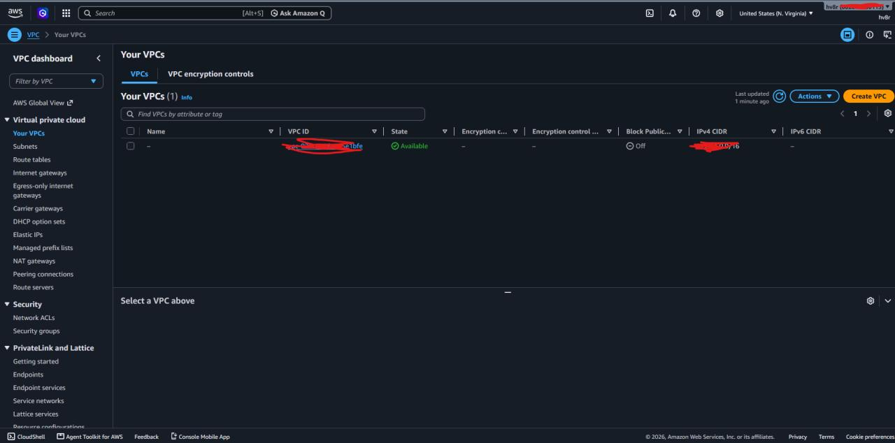
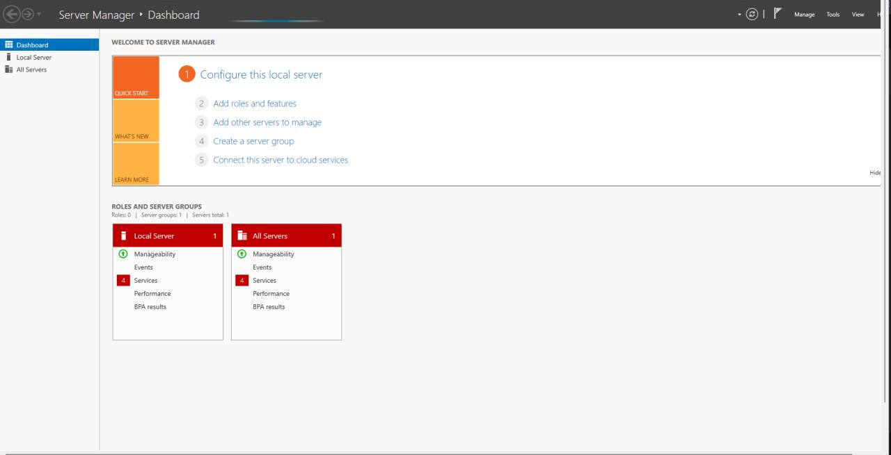
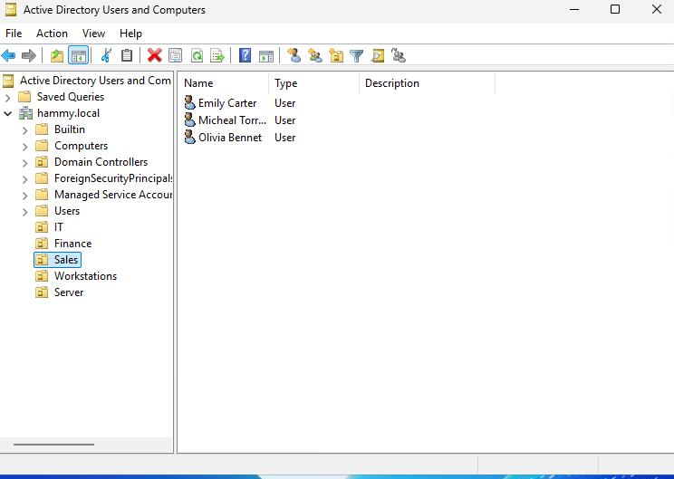

AWS Active Directory & Identity Management Lab
==============================================

Overview
--------
A self-hosted Active Directory Domain Services (AD DS) environment deployed on Amazon Web Services (AWS). This lab simulates a corporate identity management infrastructure, covering VPC network isolation, Windows Server configuration, Organizational Unit (OU) structuring, Group Policy enforcement, and PowerShell user automation.

Architecture
------------
AWS VPC (US East - N. Virginia)
├── Public Subnet (Internet Gateway)
└── Private Subnet
     ├── EC2: Windows Server (Primary Domain Controller - AD DS, DNS)
     └── EC2: Windows Client (Domain-Joined Workstation)

Technologies Used
-----------------
* Cloud: AWS EC2, VPC, Security Groups, Custom DHCP Option Sets
* Systems: Windows Server, Windows 10/11 Pro
* Identity & Networking: Active Directory (AD DS), DNS, Group Policy (GPMC)
* Scripting: PowerShell, RSAT

Step-by-Step Implementation
---------------------------

1. Cloud Infrastructure & VPC Provisioning
Provisioned an isolated Virtual Private Cloud (VPC) in AWS (US East - N. Virginia) to segment the lab network. Configured subnets, route tables, and security groups to restrict traffic to required administrative and authentication ports (RDP 3389, DNS 53, Kerberos 88, LDAP 389), then launched a Windows Server EC2 instance inside the VPC.

2. Windows Server Configuration & Role Deployment
Accessed the Windows Server instance via RDP and used Server Manager to configure local server settings, assign a static internal IP address, and install the Active Directory Domain Services (AD DS) and DNS Server roles.

3. Active Directory Forest & Organizational Unit Structure
Promoted the server to a Domain Controller for the root domain (hammy.local). Built a structured Organizational Unit (OU) hierarchy across IT, Finance, Sales, Workstations, and Server containers, and provisioned domain user accounts to mirror corporate department access.

4. Group Policy & Security Baselines
Linked Group Policy Objects (GPOs) to enforce 12-character password complexity, 5-attempt account lockout thresholds, and automatic 15-minute workstation screen locks across domain-joined machines.

Troubleshooting Highlights
--------------------------
* Domain Join DNS Failure: Client workstations initially failed to locate the domain controller because default AWS DHCP settings pointed to Amazon DNS. Resolved by configuring a custom VPC DHCP Option Set routing DNS queries directly to the Domain Controller's private IP.
* Authentication Timeouts: Audited and updated AWS Security Group and Windows Defender Firewall rules to permit internal Kerberos and LDAP traffic between instances.
